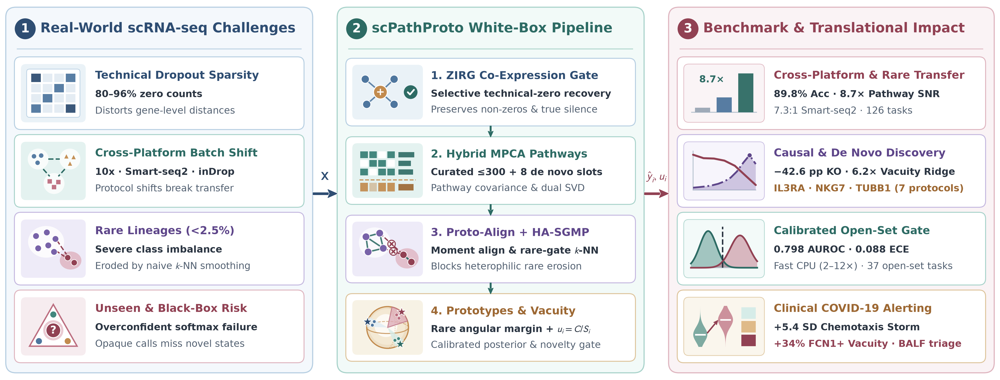
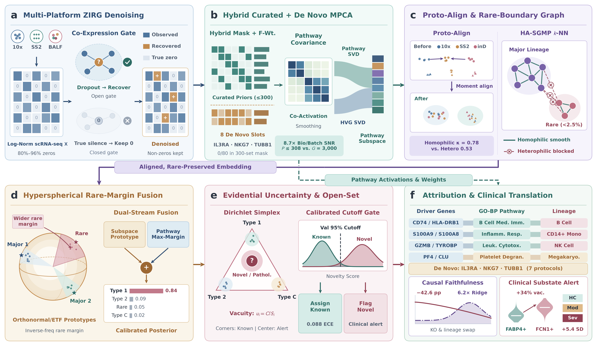

# scPathProto: Pathway-Guided Evidential Prototype Learning for Cross-Platform and Open-Set Single-Cell Annotation

[](LICENSE)
[](requirements.txt)
[](https://pytorch.org/)

Official implementation, pretrained real-atlas checkpoints (`.pth` and `.pkl`), complete 126-task benchmark tables, mechanistic/clinical experiment outputs, and publication-grade vector figures for:

> **scPathProto: Pathway-Guided Evidential Prototype Learning for Cross-Platform and Open-Set Single-Cell Annotation**  
> Fang Fang<sup>1</sup>, Yonghui Jiang<sup>2,*</sup>, and Rao Zeng<sup>2,3,*</sup>  
> <sup>1</sup> School of Information Engineering, Hainan Vocational University of Science and Technology, Haikou, China  
> <sup>2</sup> School of Artificial Intelligence, Hainan Normal University, Haikou, China  
> <sup>3</sup> Key Laboratory of Data Science and Smart Education, Ministry of Education, Hainan Normal University, Haikou, China  
> <sup>*</sup> Corresponding authors: `yh-jiang@hainnu.edu.cn`, `rao.zeng@hainnu.edu.cn`

---

## Overview

<p align="center">
  
</p>

**scPathProto** is a lightweight, CPU-efficient, white-box single-cell RNA-seq annotation framework that unites structured biological ontology priors with decoupled Subjective Logic evidential uncertainty:

1. **Zero-Inflated Residual Gate (ZIRG):** Conservatively denoises technical dropout via pathway co-expression priors while preserving observed non-zeros and true biological silence.
2. **Masked Pathway Cross-Attention (MPCA):** Combines up to 300 curated species-matched biological pathways with **8 disjoint-support *de novo* latent regulon slots** strictly outside curated masks, elevating cross-protocol biological-to-batch signal-to-noise ratio **8.67×** across 7 PBMC sequencing chemistries and recovering prior-excluded canonical drivers (*IL3RA*, *NKG7*, *TUBB1*; mean cross-protocol Spearman $\bar{\rho} = 0.884$).
3. **Proto-Align & HA-SGMP:** Composition-decoupled moment alignment removes platform drift before boundary-gated heterophily-aware subspace smoothing protects rare lineages (`< 2.5%` prevalence; homophilic $\kappa = 0.783$ vs. heterophilic $0.530$).
4. **Hyperspherical Rare-Margin Prototypes & Decoupled Dirichlet Evidential Calibration:** Cuts open-set Expected Calibration Error by roughly half (**ECE = 0.0877** across 1,087,596 query evaluations) without interfering with closed-set boundaries, verifies causal coupling under surgical knock-out (`-42.6 pp` Macro-F1, `2.38×` vacuity surge) and counterfactual swaps (`6.2×` vacuity ridge across `< 8%` HVGs), and flags infiltrating *FCN1*<sup>+</sup> hyper-inflammatory macrophages in severe COVID-19 without substate supervision (`+34.0%` median vacuity, $p < 10^{-300}$).

<p align="center">
  
</p>

---

## Headline Multi-Atlas Benchmark Summary (181,437 Cells · 126 Tasks)

Unweighted 4-dataset means across **Pancreas** (14,229 cells), **PBMC / PbmcBench** (23,154 cells), **Tabula Muris** (78,241 cells), and **Lung COVID-19 BALF** (65,813 cells); `Open ECE` is the 37-task unweighted mean:

| Method | Intra Acc | Intra Rare-F1 | Cross Acc | Cross Rare-F1 | Open AUROC | Open AUPRC | Open H-score | Open ECE (↓) |
| :--- | :---: | :---: | :---: | :---: | :---: | :---: | :---: | :---: |
| SingleR | 0.8964 | 0.7886 | 0.8302 | 0.7339 | 0.6186 | 0.2209 | 0.3186 | 0.2505 |
| scANVI | 0.9311 | 0.8360 | 0.8847 | 0.7310 | 0.7304 | 0.2332 | 0.4662 | 0.1718 |
| CellTypist | 0.9522 | 0.8647 | 0.8848 | 0.7354 | 0.7229 | 0.2445 | 0.3885 | 0.1586 |
| TOSICA | 0.9476 | 0.8699 | 0.8722 | 0.7057 | 0.7234 | 0.2488 | 0.4891 | 0.1929 |
| Linear SVM | 0.9596 | 0.8623 | 0.8918 | 0.7682 | 0.7639 | 0.2819 | **0.5944** | 0.1255 |
| **scPathProto (Ours)** | **0.9617** | **0.8778** | **0.8980** | **0.7858** | **0.7977** | **0.3333** | 0.5935 | **0.0877** |

Complete per-atlas results, Wilcoxon tests, ablation tables, and mechanistic/clinical tables are stored in `results/real_benchmark/` and `results/tables/`.

---

## Pretrained Real-Atlas Checkpoints (`checkpoints/`)

All checkpoints are trained on an 85%/15% stratified split (`G = 3,000` training-only HVGs, species-matched MSigDB/MGI pathway masks, `P_latent = 8`, `k = 15`, `m_0 = 0.18`, `tau_proto = 0.12`, `T = 45`, `seed = 0`); see [`checkpoints/checkpoint_manifest.json`](checkpoints/checkpoint_manifest.json) for SHA-256 checksums:

| Atlas | Checkpoint Files (`.pth` / `.pkl`) | Cells | Classes | Pathways (`Curated + De Novo`) | GMT Mask | Val Acc | Val Macro-F1 | Val Rare-F1 |
| :--- | :--- | :---: | :---: | :---: | :---: | :---: | :---: | :---: |
| **Pancreas** | `pancreas_scPathProto.pth` (11.61 MB) / `pancreas_scPathProto.pkl` (8.67 MB) | 14,229 | 14 | 300 + 8 | `GO_bp.gmt` | **0.9902** | **0.9926** | **0.9983** |
| **PBMC** | `pbmc_scPathProto.pth` (11.54 MB) / `pbmc_scPathProto.pkl` (12.33 MB) | 23,154 | 9 | 300 + 8 | `immune.gmt` | **0.9116** | **0.8892** | **0.7970** |
| **Tabula Muris** | `tabula_muris_scPathProto.pth` (12.43 MB) / `tabula_muris_scPathProto.pkl` (47.37 MB) | 78,241 | 74 | 300 + 8 | `m_GO_bp.gmt` | **0.9525** | **0.8502** | **0.8313** |
| **Lung COVID-19** | `lung_covid_scPathProto.pth` (11.56 MB) / `lung_covid_scPathProto.pkl` (31.29 MB) | 65,813 | 10 | 300 + 8 | `immune.gmt` | **0.9720** | **0.9069** | **0.8761** |

### Quickstart Demo

A stratified 536-cell PBMC slice spanning all 9 lineages and 8 batches is bundled at `data/demo/pbmc_demo_500cells.h5ad`. Run annotation and Dirichlet vacuity scoring directly after cloning:

```bash
python3 code/demo_inference.py
```

Or load the `.pth` / `.pkl` checkpoints programmatically:

```python
import sys, joblib, torch
sys.path.insert(0, "code")

# 1. Inspect portable PyTorch tensor bundle (.pth)
ckpt = torch.load("checkpoints/pbmc_scPathProto.pth", map_location="cpu", weights_only=False)
print("Atlas:", ckpt["dataset_name"], "| Classes:", ckpt["class_names"])
print("Hyperspherical prototypes shape:", ckpt["state_tensors"]["prototypes"].shape)
print("Gene-to-pathway W_pg shape:", ckpt["state_tensors"]["W_pg"].shape)

# 2. One-line inference & epistemic vacuity prediction (.pkl)
model = joblib.load("checkpoints/pbmc_scPathProto.pkl")
# X_query: log1p-normalized expression matrix aligned to ckpt["gene_names"] (shape [N_query, 3000])
# out = model.predict_detailed(X_query, batch_query)
# pred_labels, vacuity, novelty_score = out["pred_labels"], out["vacuity"], out["novelty_score"]
```

---

## Repository Structure

```text
scPathProto/
├── README.md                                  # Project overview, benchmarks & reproduction guide
├── LICENSE                                    # MIT License
├── requirements.txt                           # Python dependencies
├── checkpoints/                               # Real-atlas pretrained checkpoints (.pth + .pkl + manifest)
├── code/
│   ├── model.py                               # Core scPathProto engine (ScPathProtoModel & ScPathProtoTorch)
│   ├── demo_inference.py                      # 2-second zero-download quickstart demo on bundled PBMC slice
│   ├── export_checkpoints.py                  # Reproduce all 4 real-atlas .pth & .pkl checkpoints
│   ├── plot_architecture_figure.py            # Main Fig. 1 & Graphical Abstract
│   ├── plot_paper_figures.py                  # Main Figs. 2–3 & Supplementary Figs. S1–S7
│   ├── plot_mechanistic_figures.py            # Main Figs. 5–6 (Causal faithfulness & Cross-platform SNR)
│   ├── plot_clinical_and_regulon_figures.py   # Main Figs. 4 & 7 (De novo regulons & COVID-19 alerting)
│   ├── real_data/                             # 126-task benchmark & mechanistic analysis scripts
│   └── third_party/TOSICA/                    # TOSICA baseline adapter & official GMT pathway masks
├── data/
│   ├── README.md                              # Public accessions, automated download & SHA-256 verification
│   ├── demo/pbmc_demo_500cells.h5ad           # Bundled 536-cell real PBMC demo slice (9 lineages, 8 batches)
│   └── real/processed/                        # Per-atlas celltype-by-batch composition CSVs & .h5ad checksums
├── figures/                                   # All 15 final publication figures (vector .pdf + 300-DPI .png)
└── results/
    ├── real_benchmark/                        # Complete 126-task benchmark metrics, per-class F1 & runtimes
    └── tables/                                # All 47 verified CSV tables backing every figure & table in the paper
```

---

## Installation & Full Reproduction

### 1. Environment Setup
```bash
git clone https://github.com/raozeng/scPathProto.git
cd scPathProto
python3 -m venv .venv
source .venv/bin/activate
pip install --upgrade pip
pip install -r requirements.txt
```

### 2. Download the Four Public scRNA-seq Atlases
Raw `.h5ad` datasets (~1.9 GB processed) are excluded from Git due to repository size limits and are publicly accessible from their primary repositories:
- **Human Pancreas Islets:** `GSE84133` (Baron), `GSE85241` (Muraro), `E-MTAB-5061` (Segerstolpe), `GSE81608` (Xin)
- **Human PBMC (PbmcBench):** Broad Institute Single Cell Portal `SCP424` (7 sequencing chemistries)
- **Mouse Tabula Muris:** `GSE109774` / Figshare (10x Droplet & FACS Smart-seq2)
- **Human Lung COVID-19 BALF:** `GSE145926` (Liao et al., 2020) and healthy control HC4 `GSM3660650` from `GSE128033` (Morse et al., 2019)

Automated download & preprocessing:
```bash
python3 code/real_data/download_benchmarks.py --all
```

### 3. Reproduce Benchmarks, Checkpoints, Mechanistic Experiments & Figures
```bash
# A. Full 126-task multi-atlas benchmark (scPathProto + 5 baselines + 5 ablations)
bash code/run_all.sh start

# B. Rebuild real-atlas pretrained checkpoints (.pth & .pkl)
python3 code/export_checkpoints.py

# C. Reproduce mechanistic, causal perturbation, de novo regulon & clinical COVID-19 tables
python3 code/real_data/build_real_figure_tables.py
python3 code/real_data/build_mechanistic_experiments.py
python3 code/real_data/build_clinical_and_regulon_experiments.py

# D. Regenerate all 15 publication figures directly from results/tables/*.csv (no raw .h5ad needed!)
python3 code/plot_architecture_figure.py
python3 code/plot_paper_figures.py
python3 code/plot_mechanistic_figures.py
python3 code/plot_clinical_and_regulon_figures.py
```

---

## Contact

For questions or inquiries, please contact the corresponding authors:
- Yonghui Jiang: `yh-jiang@hainnu.edu.cn`
- Rao Zeng: `rao.zeng@hainnu.edu.cn`
